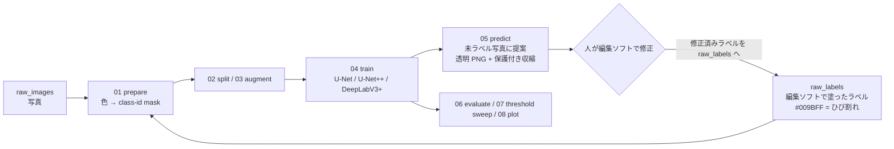

# crack-label-loop

[](https://github.com/zhouliangtingq2-dev/crack-label-loop/actions/workflows/demo.yml)

**コンクリート壁面写真のひび割れを、人手ラベリング → 学習 → 自動提案 → 修正 → 再学習のループで効率よくラベル付けするパイプライン**

[English README](README_en.md)

- **課題**：幅 4000〜6800 px の壁面写真 60 枚超に、ひび割れ幅・長さ統計用の「全画素ラベル」が必要。手描きだけでは終わらない。
- **解決**：最初の 4 枚ほどだけ手描き → モデルが次の写真を「画像編集ソフトでそのまま直せる透明 PNG」として提案 → 人は「描く」のではなく「直す」 → 直したものを教師データに戻して再学習し、次の写真へ。
- **結果**：白紙から手描きしたのは最初の 4 枚ほどで、残り 37 枚は提案を直す形で 1 シリーズ 41 枚を完成、別シリーズ 20 枚も同じ流れでラベリングして 62 枚のデータセットに。全部手描きなら約 80 時間の作業が約 20 時間で終わった（本人の見積もり）。学習に使っていないテスト 7 枚で micro IoU 0.53 / recall 0.78（U-Net+ResNet50、しきい値 0.40）。

研究室の実大 RC 壁の載荷実験で必要になり、実際に使ったツールです。このリポジトリには**コードと合成デモデータの生成スクリプトだけ**を含めています。実験写真・手描きラベル・実写真で学習した重みは研究室のデータのため公開していません（数値結果は [docs/results_real_wall.md](docs/results_real_wall.md)）。

関連リポジトリ（同じ研究室の実験で使った処理）：[wall-damage-quantification](https://github.com/zhouliangtingq2-dev/wall-damage-quantification)（剥落の抽出、ひび割れとの統合、マーカーによる mm/px の推定、損傷量の集計。このリポジトリの姉妹編）、[column-marker-tracking](https://github.com/zhouliangtingq2-dev/column-marker-tracking)（RC 柱の載荷実験の動画から、カメラの揺れを除いてマーカーを追跡し、部材角と軸方向変形を求める）。


*合成デモ（CPU 約 5 分、1 回の実行例）：左から 入力 ｜ 1 周目の自動提案 ｜ 修正 6 枚を戻して再学習した 2 周目 ｜ 正解（橙）。この実行例では 1 周目に誤検出していた丸いマーカーが 2 周目で消えている。結果は乱数・実行環境で変わる（別環境の同一シードではマーカーが残った）。*

## ループの構成



| スクリプト | 役割 |
|---|---|
| `scripts/00_make_demo_data.py` | 合成デモデータ生成（コンクリート風テクスチャ＋既知幅のひび割れ＋ラベル）。実写真は不要 |
| `scripts/01_prepare_dataset.py` | 編集ソフトで塗ったラベル PNG（透明背景でも写真に重ね描きでも可）を色距離（オプションで HSV）で抽出し、0/1/255 の class-id mask に変換。剥落（黄）は 255 = ignore |
| `scripts/02_make_splits.py` | train / val / test 分割（写真単位） |
| `scripts/03_augment_dataset.py` | 学習分割だけを 90° 回転・反転でオフライン拡張（補間なし＝細い mask が崩れない） |
| `scripts/04_train.py` | 学習。ひび割れ画素の周りを優先してパッチを切る（既定 85 %）、BCE(pos_weight)+Dice、ImageNet 事前学習エンコーダ、AMP |
| `scripts/05_predict.py` | スライディングウィンドウ推論 → 小領域除去 → **保護付き収縮**（太く塗られた部分を収縮しつつ元の 1 px 骨格は必ず残す）→ 透明 PNG / overlay / 確率マップ |
| `scripts/06_evaluate.py` | 提案 PNG と正解 mask の画素レベル IoU / Dice / precision / recall（255 は除外） |
| `scripts/07_threshold_sweep.py` | 複数しきい値で推論＋評価して表にする |
| `scripts/08_plot_history.py` | 学習曲線 |
| `scripts/check_gpu.py` | GPU とメモリの確認、推奨バッチサイズ |
| `scripts/demo_loop.py` | 上記を順に呼び、学習→提案→修正→再学習を 1 サイクル（学習 2 回）回して比較レポートを出す（CI でもこれを実行） |
| `tests/test_pipeline.py` | 保護付き収縮・ラベル変換・分割の単体テスト（`pytest -q`） |

## 学習パイプラインの中身（機械学習の流れ）

1. **ラベル → 教師データ**（`01`）：塗った PNG から `#009BFF` 近傍色の画素を色距離で拾い、ひび割れ = 1、剥落（`#FFFF00`）= 255（ignore）、他 = 0 の 8 bit mask を作る。写真と mask は同じ解像度のまま（縮小しない）。
2. **分割・拡張**（`02`・`03`）：写真単位で分割。学習分割だけ 90° 回転 3 種＋反転 2 種で 6 倍にコピー（補間を伴わない変換だけなので 1 px 幅のラベルが崩れない）。
3. **パッチサンプリング**（`04`）：学習画像は RAM に載せ、1 ステップごとにランダムな画像から 512 px（実写真）/ 128 px（デモ）のパッチを切る。**85 % のパッチはひび割れ画素の近くを中心に**切り、残り 15 % は完全ランダム（純背景を学ばせる）。ひび割れ画素は画像の 1 % 前後（0.1〜1.6 %）しかないので、ランダムに切ると正例がほとんど出ない。
4. **オンライン拡張**：反転・90° 回転・小さなアフィン（平行移動 2 %、拡縮 ±8 %、回転 ±8°）・明るさ/コントラスト/ガンマ・ガウスノイズ。ImageNet の平均・分散で正規化。
5. **モデル**：[segmentation_models.pytorch](https://github.com/qubvel-org/segmentation_models.pytorch) の U-Net（既定）/ U-Net++ / DeepLabV3+、エンコーダは ImageNet 事前学習の ResNet 等。出力は 1 チャネルのロジット。
6. **損失**：`0.6 × BCE(pos_weight = 8) + 1.0 × soft Dice`。255 の画素は損失から除外。正例重みで細いひび割れの見落とし（recall）を優先する。
7. **最適化**：AdamW（lr 3e-4、weight decay 1e-4）、コサイン減衰、CUDA では混合精度。
8. **検証**：検証画像をパッチ幅の半分の重なりで格子状に切り、エポック全体の画素を合算した IoU / Dice / recall / precision を記録（`history.csv`、`06` の micro 指標と同じ定義）。`best_model.pth` は検証 Dice で選ぶ。
9. **推論**（`05`）：画像をパッチ幅・重なり 96 px のスライディングウィンドウで通し、重なり部分の確率を平均。しきい値（既定は checkpoint に保存した値、実写真の運用は 0.50）で 2 値化 → 小領域除去 → 必要なら保護付き収縮 → `#009BFF` の透明 PNG / overlay / 確率マップを保存。
10. **評価・調整**（`06`・`07`・`08`）：提案と正解 mask の画素指標、しきい値スイープ、学習曲線。
11. **ループ**：提案 PNG を編集ソフトで直して `raw_labels/` に戻し、1. からもう一周。


*合成デモデータの例（左：入力、右：ラベル）。マルチスケールのノイズテクスチャ＋照明勾配＋骨材の斑点＋ラベルしない黒い丸（ボルト・マーカーの代わり）の上に、幅 0.5〜3.5 px のひび割れを 4 倍スーパーサンプリングで描き、PSF ぼかしとセンサノイズを加えたもの。*

## クイックスタート（合成データでループを一周）

```bash
python -m venv .venv && source .venv/bin/activate      # Windows: .venv\Scripts\activate
pip install torch torchvision --index-url https://download.pytorch.org/whl/cu128   # GPU。CPU なら --index-url .../cpu
pip install -r requirements.txt
python scripts/demo_loop.py --root demo_runs --no-pretrained   # 約 5 分（CPU）。下表はこの設定の一例
# ネットがあれば --no-pretrained を外すと ImageNet 事前学習エンコーダを使う（数値は変わる）
pytest -q                                                       # 単体テスト（任意）
```

`demo_runs/report/report.md` に 1 周目・2 周目の数値と上の比較図ができます。

| セット | 周 | IoU | Dice | precision | recall |
|---|---|---|---|---|---|
| pool（人が直す提案） | 1 | 0.747 | 0.855 | 0.795 | 0.926 |
| test（最後まで見せない） | 1 | 0.780 | 0.877 | 0.807 | 0.959 |
| test | 2（修正 6 枚を追加） | **0.849** | **0.918** | 0.877 | 0.963 |

（U-Net/ResNet18・事前学習なし・384 px 画像／128 px パッチ・6 エポック×50 ステップの小さな設定。デモでは「人の修正」を隠しておいた正解ラベルの開示で代用しているので、2 周目の向上は「正しく修正された 6 枚を教師データに加えた効果」を示すものです。数値は乱数・環境で ±0.05 程度変わります。）


*デモ 2 周目の検証指標（6 エポックでまだ上昇中＝デモは意図的に短い）。*

## 自分の写真で使う

```bash
# 1. 写真を data/raw_images/、編集ソフトで塗ったラベルを同じファイル名で data/raw_labels/ に置く
#    ひび割れ = #009BFF (0,155,255)、剥落（あれば）= #FFFF00、背景 = 透明または黒
python scripts/01_prepare_dataset.py --images data/raw_images --labels data/raw_labels --out data/processed
python scripts/02_make_splits.py     --data data/processed --out data/splits --train 0.7 --val 0.15 --test 0.15
python scripts/03_augment_dataset.py --input data/processed --splits data/splits --out data/processed_aug --out-splits data/splits_aug
# 2. 学習（12 GB GPU の目安。8 GB なら --batch-size 4。学習画像は RAM に載せるので 25 MP × 枚数 × 約 100 MB を見込む）
python scripts/04_train.py --data data/processed_aug --splits data/splits_aug --out runs/r1 \
       --model unet --encoder resnet34 --patch-size 512 --batch-size 8 --epochs 80 --steps-per-epoch 300
# 3. 未ラベル写真に提案 → runs/pred_new/affinity_png/*.png を編集ソフトで開いて直す
python scripts/05_predict.py --checkpoint runs/r1/best_model.pth --images data/new_images --out runs/pred_new --erode-pixels 2
# 4. 直したラベルを data/raw_labels/ に戻して 1. からもう一周
# 5. しきい値や後処理の比較（patch size は checkpoint の値が使われる）
python scripts/07_threshold_sweep.py --checkpoint runs/r1/best_model.pth --images data/processed/images \
       --masks data/processed/masks_id --split data/splits/val.txt --out runs/sweep --thresholds 0.3 0.4 0.5 0.6
```

動作確認：Python 3.11 / 3.13、torch 2.x、albumentations 2.0.x、segmentation-models-pytorch 0.6（`requirements.txt`）。

## 設計上の判断（なぜこうしたか）

- **ひび割れだけを学習する（剥落は ignore）**：ひび割れ画素は画像の 1 % 前後、剥落はさらに少ない。3 クラスで学習すると簡単に崩れたので、ひび割れを 2 値で安定させ、剥落は別モデルにした。
- **正例中心のパッチサンプリング＋pos_weight**：ランダムにパッチを切るとほとんど背景だけになる。85 % のパッチをひび割れ画素の近くから切り、BCE に正例重み 8 を掛け、Dice を足している。
- **保護付き収縮（protected narrowing）**：モデルは細いひび割れを手描きより 1.2〜1.7 倍（1〜3 px 程度）太く塗りがちで、そのままだと修正の手間と幅統計に響く。単純な収縮は細いひび割れを消すので、「収縮した mask ∪ 元 mask の骨格」とし、1 px の線は必ず残す。研究室の先行手法（外郭削り＋細線化保護）を予測後処理として実装し直したもの。提案を人が直す段階では `--erode-pixels 2` で使い、評価と幅計測に使う最終設定（docs 参照）では収縮なし＝幅は修正後の mask から取る。
- **出力を編集ソフトの形式に合わせる**：提案は `#009BFF` の透明 PNG。人は Affinity Photo / GIMP / Photoshop で開いて消しゴムと筆で直すだけで、それがそのまま次の教師データになる。ツール間の変換を一切なくしたことが、ループが実際に回った一番の理由。
- **IoU が低く見える理由**：数 px 幅の線は境界が 1 px ずれるだけで IoU が半減する（幅 w px の線が 1 px ずれると IoU = (w−1)/(w+1)）。実写真では AI mask が手描きより太いことが主因で、骨格の長さで比べると（許容 2 mm）テストで再現率 0.92・適合率 0.96 と位置はほぼ合っている。実写真では recall（細いひび割れを落としていないか）と、修正にかかる時間の減り方を主に見た。

## 実写真での結果

研究室の実大 RC 壁実験の写真 62 枚（正解ラベルは、最初の 4 枚ほどだけ白紙から手描きし、残りは提案を修正して作成）で、U-Net+ResNet34 / ResNet50 / DeepLabV3+(ResNet50) を同一条件（しきい値 0.40・後処理なし）で比較しました。学習に使っていないテスト 7 枚で U-Net+ResNet50 が micro IoU 0.53 / Dice 0.69 / recall 0.78（検証 9 枚で IoU 0.60 / Dice 0.75）と最良で、これを採用し、運用時のしきい値は検証分割でのスイープから 0.50 にしました。分割は写真単位で、同じ試験体の別の荷重ステップが train と test の両方に入っているため、この数値は「同じ壁の未ラベル写真に対する提案の精度」であり、未知の壁への汎化性能ではありません。また、ラベルの大半はモデルの提案を人が直したものなので、モデルの癖（線の太さなど）がラベル側に残り、数値が実力よりやや良く出ている可能性があります。詳細は [docs/results_real_wall.md](docs/results_real_wall.md)（写真は非公開、数値のみ）。

## 制限と今後

- 現状は「提案を人が直す」前提のツールで、無修正で幅統計に使える精度ではない（特に 1 px 未満のひび割れ）。
- 学習画像を RAM に載せる実装のため、25 MP 級の写真を数百枚扱うにはメモリが要る（遅延読み込みが改善候補）。
- 剥落の学習・ひび割れとの統合・マーカーによる mm/px 推定・損傷量（ひび割れの長さ、剥落の面積など）の抽出は、姉妹リポジトリ [wall-damage-quantification](https://github.com/zhouliangtingq2-dev/wall-damage-quantification) にまとめて公開した。骨格からの幅分布の抽出は含めていない。
- ひび割れ**幅**そのものの画像計測（サブピクセル）は別の研究テーマとして進行中。

## 開発について

研究室の実験で必要になった課題設定・ワークフロー設計・実データでの検証・評価は自分で行いました。コードの初稿は生成 AI（ChatGPT / Claude）に書かせ、仕様の指示、動作確認、不具合の修正、ハイパーパラメータと後処理の調整は自分で行っています（データセット v1→v4、モデル 3 種、しきい値スイープ）。実写真の数値は研究室内の元実装（拡張に `ShiftScaleRotate` を使用）で得たもので、公開版は同等の `Affine` に置き換えています。

## ライセンス

MIT License（コード）。依存ライブラリ：PyTorch、[segmentation_models.pytorch](https://github.com/qubvel-org/segmentation_models.pytorch)、albumentations、scikit-image、OpenCV。

---
周 亮廷 (ZHOU Liangting) — 東北大学大学院 工学研究科 都市・建築学専攻（修士 2 年）
