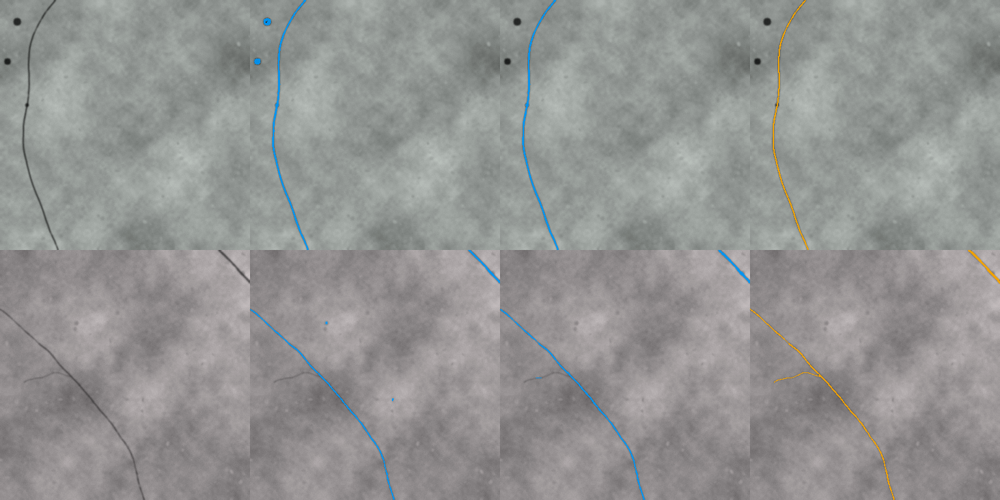
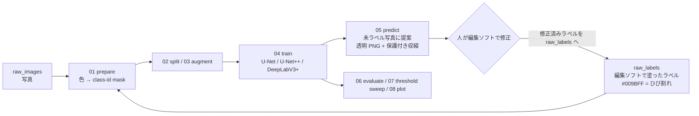

# crack-label-loop

[](https://github.com/zhouliangtingq2-dev/crack-label-loop/actions/workflows/demo.yml)

**コンクリート壁面写真のひび割れを、人手ラベリング → 学習 → 自動提案 → 修正 → 再学習のループで効率よくラベル付けするパイプライン**

[English README](README_en.md)

研究室の実大 RC 壁の載荷実験（約 25 メガピクセルの壁面写真、初期 41 枚）で、ひび割れ幅・長さの統計を取るための「全画素ラベル」が必要になり、手描きだけでは終わらなかったことから作ったツールです。実際に 41 枚の手描きから始めて別シリーズ 20 枚をモデル提案＋修正でラベリングし、62 枚のデータセットにしました。
最初の数枚を画像編集ソフトで塗る → モデルが残りの写真に**編集ソフトでそのまま開ける透明 PNG** として提案を出す → 人は「描く」のではなく「直す」だけ → 直したものを教師データに戻して再学習、を繰り返します。

> このリポジトリには**コードと合成デモデータだけ**を含めています。実験写真・実写真で学習した重みは研究室のデータのため公開していません（数値結果は [docs/results_real_wall.md](docs/results_real_wall.md)）。



*合成デモ（CPU 約 5 分）：左から 入力 ｜ 1 周目の自動提案 ｜ 修正を戻して再学習した 2 周目 ｜ 正解（橙）。1 周目で誤検出していた丸いマーカーが 2 周目では消え、細い分岐も拾えるようになる。*

## ループの構成



| スクリプト | 役割 |
|---|---|
| `scripts/00_make_demo_data.py` | 合成デモデータ生成（コンクリート風テクスチャ＋既知幅のひび割れ＋ラベル）。実写真は不要 |
| `scripts/01_prepare_dataset.py` | 編集ソフトで塗ったラベル PNG（透明背景でも写真に重ね描きでも可）を色距離・HSV で抽出し、0/1/255 の class-id mask に変換。剥落（黄）は 255 = ignore |
| `scripts/02_make_splits.py` | train / val / test 分割 |
| `scripts/03_augment_dataset.py` | 学習分割だけを 90° 回転・反転でオフライン拡張（補間なし＝細い mask が崩れない） |
| `scripts/04_train.py` | 学習。ひび割れ画素の周りを優先してパッチを切る（既定 85 %）、BCE(pos_weight)+Dice、ImageNet 事前学習エンコーダ、AMP |
| `scripts/05_predict.py` | スライディングウィンドウ推論 → 小領域除去 → **保護付き収縮**（太く塗られた部分を収縮しつつ元の 1 px 骨格は必ず残す）→ 透明 PNG / overlay / 確率マップ |
| `scripts/06_evaluate.py` | 提案 PNG と正解 mask の画素レベル IoU / Dice / precision / recall（255 は除外） |
| `scripts/07_threshold_sweep.py` | 複数しきい値で推論＋評価して表にする |
| `scripts/08_plot_history.py` | 学習曲線 |
| `scripts/demo_loop.py` | 上記を順に呼び、ループを 2 周回して比較レポートを出す（CI でもこれを実行） |

## クイックスタート（合成データでループを一周）

```bash
python -m venv .venv && source .venv/bin/activate      # Windows: .venv\Scripts\activate
pip install torch torchvision --index-url https://download.pytorch.org/whl/cu128   # GPU の場合。CPU なら --index-url .../cpu
pip install -r requirements.txt
python scripts/demo_loop.py --root demo_runs            # 約 5 分（CPU）。ネットが無ければ --no-pretrained
```

`demo_runs/report/report.md` に 1 周目・2 周目の数値と上の比較図ができます。

| セット | 周 | IoU | Dice | precision | recall |
|---|---|---|---|---|---|
| pool（人が直す提案） | 1 | 0.747 | 0.855 | 0.795 | 0.926 |
| test（最後まで見せない） | 1 | 0.780 | 0.877 | 0.807 | 0.959 |
| test | 2（修正 6 枚を追加） | **0.849** | **0.918** | 0.877 | 0.963 |

（U-Net/ResNet18・事前学習なし・384 px・6 エポックの小さな設定。数値は乱数で多少変わります。）

## 自分の写真で使う

```bash
# 1. 写真を data/raw_images/、編集ソフトで塗ったラベルを同じファイル名で data/raw_labels/ に置く
#    ひび割れ = #009BFF (0,155,255)、剥落（あれば）= #FFFF00、背景 = 透明または黒
python scripts/01_prepare_dataset.py --images data/raw_images --labels data/raw_labels --out data/processed
python scripts/02_make_splits.py     --data data/processed --out data/splits --train 0.7 --val 0.15 --test 0.15
python scripts/03_augment_dataset.py --input data/processed --splits data/splits --out data/processed_aug --out-splits data/splits_aug
# 2. 学習（12 GB GPU の目安。8 GB なら --batch-size 4）
python scripts/04_train.py --data data/processed_aug --splits data/splits_aug --out runs/r1 \
       --model unet --encoder resnet34 --patch-size 512 --batch-size 8 --epochs 80 --steps-per-epoch 300
# 3. 未ラベル写真に提案 → runs/pred_new/affinity_png/*.png を編集ソフトで開いて直す
python scripts/05_predict.py --checkpoint runs/r1/best_model.pth --images data/new_images --out runs/pred_new --erode-pixels 2
# 4. 直したラベルを data/raw_labels/ に戻して 1. からもう一周
# 5. しきい値や後処理の比較
python scripts/07_threshold_sweep.py --checkpoint runs/r1/best_model.pth --images data/processed/images \
       --masks data/processed/masks_id --split data/splits/val.txt --out runs/sweep --thresholds 0.3 0.4 0.5 0.6
```

## 設計上の判断（なぜこうしたか）

- **ひび割れだけを学習する（剥落は ignore）**：ひび割れ画素は画像の 0.1 % 程度、剥落はさらに少ない。3 クラスで学習すると簡単に崩れたので、ひび割れを 2 値で安定させ、剥落は別モデルにした。
- **正例中心のパッチサンプリング＋pos_weight**：ランダムにパッチを切るとほとんど背景だけになる。85 % のパッチをひび割れ画素の近くから切り、BCE に正例重み 8 を掛け、Dice を足している。
- **保護付き収縮（protected narrowing）**：モデルは細いひび割れを 2–4 px 太く塗りがちで、そのままだと幅統計が狂う。単純な収縮は細いひび割れを消すので、「収縮した mask ∪ 元 mask の骨格」とし、1 px の線は必ず残す。
- **出力を編集ソフトの形式に合わせる**：提案は `#009BFF` の透明 PNG。人は Affinity Photo / GIMP / Photoshop で開いて消しゴムと筆で直すだけで、それがそのまま次の教師データになる。ツール間の変換を一切なくしたことが、ループが実際に回った一番の理由。
- **IoU が低く見える理由**：数 px 幅の線は境界が 1 px ずれるだけで IoU が半減する。実写真では recall（細いひび割れを落としていないか）と、修正にかかる時間の減り方を主に見た。

## 実写真での結果

研究室の実大 RC 壁実験の写真 62 枚（手描き 41 枚＋提案を修正した 20 枚ほか）で、U-Net+ResNet34 / ResNet50 / DeepLabV3+(ResNet50) を比較し、最終的に U-Net+ResNet50・しきい値 0.50 を採用。留め出しのテスト 7 枚で micro IoU 0.53 / Dice 0.69 / recall 0.78、検証 9 枚で IoU 0.60 / Dice 0.75。詳細と考察は [docs/results_real_wall.md](docs/results_real_wall.md)（写真は非公開、数値のみ）。

## 制限と今後

- 現状は「提案を人が直す」前提のツールで、無修正で幅統計に使える精度ではない（特に 1 px 未満のひび割れ）。
- 剥落の学習・ひび割れとの統合・マーカーによる mm/px 推定・骨格→幅分布の抽出は別スクリプトで運用しており、このリポジトリには含めていない。
- ひび割れ**幅**そのものの画像計測（サブピクセル）は別の研究テーマとして進行中。

## 開発について

研究室の実験で必要になった課題設定・ワークフロー設計・実データでの検証は自分で行い、実装には生成 AI（ChatGPT / Claude）を活用しました。スクリプトの構成・ハイパーパラメータ・後処理は実写真での試行錯誤（データセット v1→v4、モデル 3 種、しきい値スイープ）を経て決めています。

## ライセンス

MIT License（コード）。依存ライブラリ：PyTorch、[segmentation_models.pytorch](https://github.com/qubvel-org/segmentation_models.pytorch)、albumentations、scikit-image、OpenCV。

---
周 亮廷 (ZHOU Liangting) — 東北大学大学院 工学研究科（都市・建築学専攻）
