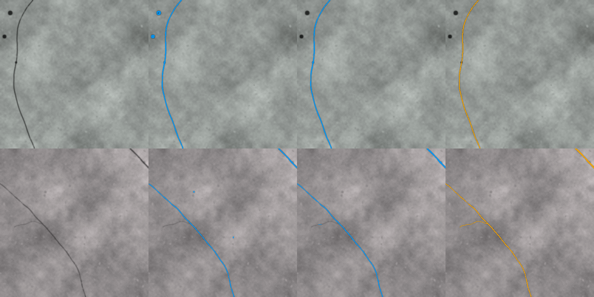
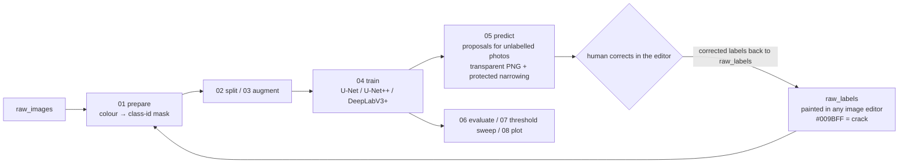
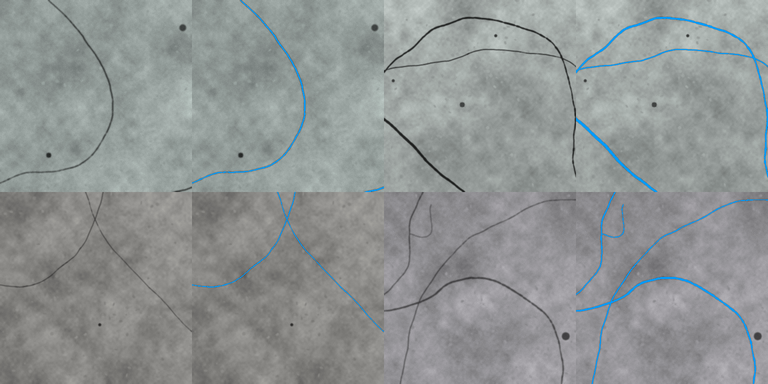
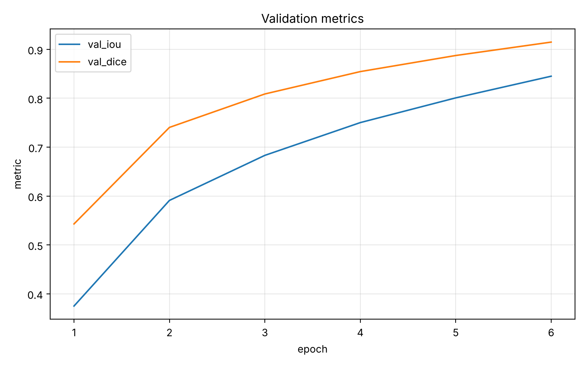

# crack-label-loop

[](https://github.com/zhouliangtingq2-dev/crack-label-loop/actions/workflows/demo.yml)

**A human-in-the-loop pipeline for labelling cracks in concrete wall photographs: paint a few → train → the model proposes labels for the rest as editable PNGs → correct instead of draw → retrain.**

[日本語 README](README.md)

- **Problem** — a full-scale RC wall loading test produced 60+ wall photographs 4000–6800 px wide, and every-pixel crack labels were needed for width/length statistics. Painting them all by hand did not scale.
- **Approach** — paint only the first four or so images by hand → the model proposes the label for the next photograph as a *transparent PNG that opens directly in an image editor* → people **correct** instead of **draw** → the corrected file goes back in as a training label, the model is retrained, and the next photograph follows.
- **Outcome** — only the first four or so images were painted from scratch; the remaining 37 of the 41-image series, and 20 images of another series, were labelled by correcting proposals, giving a 62-image dataset. Work that would have taken about 80 hours fully by hand took about 20 hours (my own estimate). On 7 held-out test images: micro IoU 0.53 / recall 0.78 (U-Net + ResNet50, threshold 0.40).

This tool was built because the laboratory experiment needed it, and it was used in practice. The repository contains **the code and a synthetic demo-data generator only**. The experiment photographs, the hand-painted labels and the weights trained on them belong to the laboratory and are not published; the numbers obtained on them are in [docs/results_real_wall.md](docs/results_real_wall.md).



*Synthetic demo (~5 min on CPU, one example run): input | round-1 proposals | round-2 result after 6 corrected images were fed back | ground truth (orange). In this run the round marker that was falsely labelled in round 1 disappears in round 2. Results vary with the random seed and the environment (on another machine the same seed kept the marker).*

## The loop



| script | role |
|---|---|
| `scripts/00_make_demo_data.py` | synthetic concrete-like images with cracks of known (sub-pixel to few-pixel) width and their labels; no photographs needed |
| `scripts/01_prepare_dataset.py` | converts painted label PNGs (transparent, or painted over the photo) into 0/1/255 class-id masks by colour distance (optionally HSV); spalling (yellow) becomes 255 = ignore |
| `scripts/02_make_splits.py` | train / val / test split (per photograph) |
| `scripts/03_augment_dataset.py` | offline 90° rotations and flips of the training split only (no interpolation, so thin masks stay exact) |
| `scripts/04_train.py` | training: crack-centred patch sampling (85 % by default), BCE(pos_weight) + Dice, ImageNet-pretrained encoders, AMP |
| `scripts/05_predict.py` | sliding-window inference → small-component removal → **protected narrowing** (erode over-painted regions but always keep the original 1-px skeleton) → transparent PNG / overlay / probability map |
| `scripts/06_evaluate.py` | pixel IoU / Dice / precision / recall of proposals against masks (255 excluded) |
| `scripts/07_threshold_sweep.py` | predict + evaluate for several thresholds |
| `scripts/08_plot_history.py` | training curves |
| `scripts/check_gpu.py` | GPU / memory check and a suggested batch size |
| `scripts/demo_loop.py` | runs the scripts above for one full cycle (two trainings) and writes a comparison report; also used by CI |
| `tests/test_pipeline.py` | unit tests for protected narrowing, label conversion and splitting (`pytest -q`) |

## What happens inside the training pipeline

1. **Labels → training masks** (`01`): pixels near `#009BFF` are picked by colour distance from the painted PNG; crack = 1, spalling (`#FFFF00`) = 255 (ignore), everything else = 0, stored as an 8-bit mask at the photograph's full resolution (no downscaling).
2. **Split and augment** (`02`, `03`): split per photograph. Only the training split is copied 6× with three 90° rotations and two flips — transformations without interpolation, so 1-px labels survive.
3. **Patch sampling** (`04`): training images are held in RAM and each step cuts a patch (512 px for the real photographs, 128 px in the demo) from a random image. **85 % of the patches are centred near a crack pixel**, the remaining 15 % are fully random so that pure background is learned too. Crack pixels are about 1 % of an image (0.1–1.6 %), so random patches would almost never contain positives.
4. **Online augmentation**: flips, 90° rotations, a small affine transform (translate 2 %, scale ±8 %, rotate ±8°), brightness/contrast/gamma, Gaussian noise; ImageNet mean/std normalisation.
5. **Model**: U-Net (default) / U-Net++ / DeepLabV3+ from [segmentation_models.pytorch](https://github.com/qubvel-org/segmentation_models.pytorch) with ImageNet-pretrained encoders (ResNet etc.); one-channel logit output.
6. **Loss**: `0.6 × BCE(pos_weight = 8) + 1.0 × soft Dice`; pixels marked 255 are excluded. The positive weight favours recall on thin cracks.
7. **Optimisation**: AdamW (lr 3e-4, weight decay 1e-4), cosine decay, mixed precision on CUDA.
8. **Validation**: validation images are tiled with half-patch overlap; IoU / Dice / recall / precision are pooled over all pixels of the epoch (`history.csv`, same definition as the micro metrics of `06`). `best_model.pth` is selected by validation Dice.
9. **Inference** (`05`): sliding window with the patch size and 96 px overlap, probabilities averaged in the overlaps; threshold (default: the value stored in the checkpoint; 0.50 in production on the real photographs) → small-component removal → optional protected narrowing → `#009BFF` transparent PNG / overlay / probability map.
10. **Evaluation and tuning** (`06`, `07`, `08`): pixel metrics against the masks, threshold sweep, training curves.
11. **Loop**: correct the proposal PNGs in the editor, drop them into `raw_labels/`, go back to step 1.



*Synthetic demo data (left: input, right: label). Multi-scale noise texture + illumination gradient + aggregate speckles + unlabelled dark blobs (stand-ins for bolts and markers), with cracks 0.5–3.5 px wide drawn at 4× supersampling, then PSF blur and sensor noise.*

## Quick start (one loop on synthetic data)

```bash
python -m venv .venv && source .venv/bin/activate      # Windows: .venv\Scripts\activate
pip install torch torchvision --index-url https://download.pytorch.org/whl/cu128   # GPU; for CPU use --index-url .../cpu
pip install -r requirements.txt
python scripts/demo_loop.py --root demo_runs --no-pretrained   # ~5 min on CPU; the table below is one run of this setting
# with network access, drop --no-pretrained to use ImageNet-pretrained encoders (numbers change)
pytest -q                                                       # unit tests (optional)
```

`demo_runs/report/report.md` contains the round-1 / round-2 numbers and the comparison figure above.

| set | round | IoU | Dice | precision | recall |
|---|---|---|---|---|---|
| pool (proposals a human would correct) | 1 | 0.747 | 0.855 | 0.795 | 0.926 |
| test (never shown) | 1 | 0.780 | 0.877 | 0.807 | 0.959 |
| test | 2 (+6 corrected images) | **0.849** | **0.918** | 0.877 | 0.963 |

(U-Net/ResNet18, no pretrained weights, 384 px images / 128 px patches, 6 epochs × 50 steps — a deliberately small setting. In the demo the "human correction" is simulated by revealing the hidden ground-truth labels, so the round-2 gain shows the effect of adding 6 correctly corrected images to the training set. Numbers vary by about ±0.05 with the seed and the environment.)



*Validation metrics of demo round 2 (still rising after 6 epochs — the demo is intentionally short).*

## Using your own photographs

```bash
# 1. photographs in data/raw_images/, labels painted in your editor under the same file names in data/raw_labels/
#    crack = #009BFF (0,155,255), spalling (if any) = #FFFF00, background = transparent or black
python scripts/01_prepare_dataset.py --images data/raw_images --labels data/raw_labels --out data/processed
python scripts/02_make_splits.py     --data data/processed --out data/splits --train 0.7 --val 0.15 --test 0.15
python scripts/03_augment_dataset.py --input data/processed --splits data/splits --out data/processed_aug --out-splits data/splits_aug
# 2. train (settings for a 12 GB GPU; use --batch-size 4 on 8 GB. Training images are held in RAM: budget ~100 MB per 25-MP image)
python scripts/04_train.py --data data/processed_aug --splits data/splits_aug --out runs/r1 \
       --model unet --encoder resnet34 --patch-size 512 --batch-size 8 --epochs 80 --steps-per-epoch 300
# 3. proposals for unlabelled photographs → open runs/pred_new/affinity_png/*.png in your editor and correct them
python scripts/05_predict.py --checkpoint runs/r1/best_model.pth --images data/new_images --out runs/pred_new --erode-pixels 2
# 4. put the corrected labels into data/raw_labels/ and repeat from 1.
# 5. compare thresholds / post-processing (the patch size is taken from the checkpoint)
python scripts/07_threshold_sweep.py --checkpoint runs/r1/best_model.pth --images data/processed/images \
       --masks data/processed/masks_id --split data/splits/val.txt --out runs/sweep --thresholds 0.3 0.4 0.5 0.6
```

Tested with Python 3.11 / 3.13, torch 2.x, albumentations 2.0.x, segmentation-models-pytorch 0.6 (`requirements.txt`).

## Design decisions (and why)

- **Crack-only training, spalling as ignore** — crack pixels are about 1 % of an image and spalling is rarer still. A 3-class model collapsed easily, so cracks are trained as a stable binary problem and spalling is handled by a separate model.
- **Crack-centred patch sampling + pos_weight** — random patches are almost all background. 85 % of the patches are cut around crack pixels, BCE gets a positive weight of 8, and Dice is added.
- **Protected narrowing** — the model tends to paint thin cracks 1.2–1.7× (about 1–3 px) wider than the hand labels, which costs correction time and biases width statistics. Plain erosion deletes thin cracks, so the output is `erode(mask) ∪ skeleton(mask)`: a 1-px line always survives. This re-implements, as a prediction post-process, a prior method used in the laboratory (outline trimming with thinning protection). `--erode-pixels 2` is used when proposals go to a human for correction; the final setting used for evaluation and width measurement (see docs) uses no erosion, i.e. widths are taken from the corrected masks.
- **Output in the editor's own format** — proposals are `#009BFF` transparent PNGs. People open them in Affinity Photo / GIMP / Photoshop, fix them with eraser and brush, and the file *is* the next training label. Removing every conversion step between tools is the main reason the loop actually got used.
- **Why IoU looks low** — for a line a few pixels wide, a 1-px boundary offset halves the IoU (a w-px line shifted by 1 px gives IoU = (w−1)/(w+1)). On the real photographs the main cause is that the AI mask is wider than the hand label; compared along the skeleton (2 mm tolerance) the test set gives recall 0.92 / precision 0.96, i.e. the positions mostly agree. On real photographs, recall (are thin cracks being missed?) and the reduction in correction time were what we mainly looked at.

## Results on real photographs

62 photographs from the laboratory's full-scale RC wall test (labels: the first four or so painted from scratch, the rest produced by correcting proposals); U-Net + ResNet34 / ResNet50 and DeepLabV3+ (ResNet50) compared under the same conditions (threshold 0.40, no post-processing). On the 7 held-out test images U-Net + ResNet50 was best with micro IoU 0.53 / Dice 0.69 / recall 0.78 (validation, 9 images: IoU 0.60 / Dice 0.75) and was adopted; the operating threshold was set to 0.50 from a sweep on the validation split. The split is per photograph, but other loading steps of the same specimen appear in both train and test, so these numbers describe the quality of proposals for *unlabelled photographs of the same wall*, not generalisation to unseen walls. Most labels were produced by correcting the model's own proposals, so some of the model's habits (line thickness, for example) may remain in the labels and the scores may be slightly flattering. Details in [docs/results_real_wall.md](docs/results_real_wall.md) (numbers only; photographs are not published).

## Limitations and next steps

- The tool assumes a human corrects the proposals; the output is not accurate enough for width statistics without correction (especially cracks below 1 px).
- Training images are held in RAM, so hundreds of 25-MP photographs need a lot of memory (lazy loading is a candidate improvement).
- Spalling training, fusion with cracks, mm/px estimation from markers and skeleton → width-distribution extraction run as separate scripts and are not included here.
- Image-based measurement of crack **width** itself (sub-pixel) is a separate ongoing research topic.

## Development note

The problem setting, the workflow design, and the validation and evaluation on real data for the laboratory experiment are my own. The first drafts of the code were written by generative AI (ChatGPT / Claude); specifying the behaviour, testing, fixing defects, and tuning hyper-parameters and post-processing were done by me (dataset v1→v4, three model families, threshold sweeps). The real-photograph numbers were obtained with the laboratory's original implementation (which used `ShiftScaleRotate` for augmentation); the published version uses the equivalent `Affine`.

## License

MIT License (code). Dependencies: PyTorch, [segmentation_models.pytorch](https://github.com/qubvel-org/segmentation_models.pytorch), albumentations, scikit-image, OpenCV.

---
ZHOU Liangting — Graduate School of Engineering, Tohoku University (2nd-year master's student)
