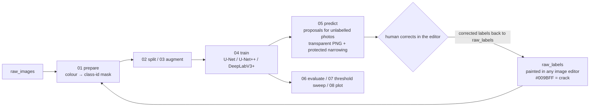

# crack-label-loop

**A human-in-the-loop pipeline for labelling cracks in concrete wall photographs: paint a few → train → the model proposes labels for the rest as editable PNGs → correct instead of draw → retrain.**

[日本語 README](README.md)

Built for a full-scale RC wall loading test in our laboratory (~25-megapixel wall photographs, 41 hand-labelled at the start) where every-pixel crack labels were needed for width/length statistics and hand labelling alone did not scale. In practice the loop took 41 hand-painted images, proposed labels for 20 images of another series, and after correction produced a 62-image dataset.

> This repository contains **code and a synthetic demo only**. The experiment photographs and the weights trained on them belong to the laboratory and are not published; the numbers obtained on them are in [docs/results_real_wall.md](docs/results_real_wall.md).


*Synthetic demo (~5 min on CPU): input | round-1 proposal | round-2 result after the corrections were fed back | ground truth (orange). The round marker falsely labelled in round 1 disappears in round 2 and the thin branch is picked up.*

## The loop



| script | role |
|---|---|
| `00_make_demo_data.py` | synthetic concrete-like images with cracks of known (sub-pixel to few-pixel) width and their labels; no photographs needed |
| `01_prepare_dataset.py` | converts painted label PNGs (transparent or painted over the photo) into 0/1/255 masks by colour distance / HSV; spalling (yellow) becomes 255 = ignore |
| `02_make_splits.py` | train / val / test split |
| `03_augment_dataset.py` | offline 90° rotations and flips of the training split only (no interpolation, thin masks stay exact) |
| `04_train.py` | training: crack-centred patch sampling (85 % by default), BCE(pos_weight) + Dice, ImageNet-pretrained encoders, AMP |
| `05_predict.py` | sliding-window inference → small-component removal → **protected narrowing** (erode over-painted regions but always keep the 1-px skeleton) → transparent PNG / overlay / probability map |
| `06_evaluate.py` | pixel IoU / Dice / precision / recall of proposals against masks (255 excluded) |
| `07_threshold_sweep.py` | predict + evaluate for several thresholds |
| `08_plot_history.py` | training curves |
| `demo_loop.py` | runs the scripts above for two rounds and writes a comparison report (also used by CI) |

## Quick start

```bash
python -m venv .venv && source .venv/bin/activate
pip install torch torchvision --index-url https://download.pytorch.org/whl/cu128   # or .../cpu
pip install -r requirements.txt
python scripts/demo_loop.py --root demo_runs        # ~5 min on CPU; add --no-pretrained when offline
```

| set | round | IoU | Dice | precision | recall |
|---|---|---|---|---|---|
| pool (proposals the human corrects) | 1 | 0.747 | 0.855 | 0.795 | 0.926 |
| test (held out) | 1 | 0.780 | 0.877 | 0.807 | 0.959 |
| test | 2 (+6 corrected images) | **0.849** | **0.918** | 0.877 | 0.963 |

(U-Net/ResNet18, no pretrained weights, 384 px, 6 epochs — a deliberately small setting; numbers vary slightly with the seed.)

## Using your own photographs

See the command sequence in the Japanese README; the steps are prepare → split → augment → train → predict → correct the PNGs in your editor → put them back into `raw_labels` → repeat.

## Design decisions

- **Crack-only training, spalling as ignore** — crack pixels are ~0.1 % of the image and spalling is rarer; a 3-class model collapsed, a binary one was stable.
- **Crack-centred patch sampling + pos_weight** — random patches are almost all background; 85 % of patches are cut around crack pixels, BCE gets a positive weight of 8 and Dice is added.
- **Protected narrowing** — the model paints thin cracks 2–4 px too wide, which corrupts width statistics; plain erosion deletes thin cracks, so the output is `erode(mask) ∪ skeleton(mask)`.
- **Output in the editor's own format** — proposals are `#009BFF` transparent PNGs that open directly in Affinity Photo / GIMP / Photoshop; the corrected file *is* the next training label. Removing every conversion step is what made the loop actually get used.
- **Why IoU looks low** — for lines a few pixels wide a 1-px boundary offset halves the IoU; on real photos recall and the drop in correction time were the metrics that mattered.

## Results on real photographs

62 labelled photographs from a full-scale RC wall test (41 hand-painted + 20 proposed-and-corrected + 1); U-Net+ResNet34 / ResNet50 and DeepLabV3+(ResNet50) compared; U-Net+ResNet50 at threshold 0.50 was adopted. Held-out test (7 images): micro IoU 0.53 / Dice 0.69 / recall 0.78; validation (9 images): IoU 0.60 / Dice 0.75. Details in [docs/results_real_wall.md](docs/results_real_wall.md).

## Development note

Problem setting, workflow design and validation on real data are my own; the implementation was done with the help of generative AI (ChatGPT / Claude). Script structure, hyper-parameters and post-processing were settled through iterations on real photographs (dataset v1→v4, three model families, threshold sweeps).

## License

MIT (code). Dependencies: PyTorch, segmentation_models.pytorch, albumentations, scikit-image, OpenCV.

---
ZHOU Liangting — Graduate School of Engineering, Tohoku University
